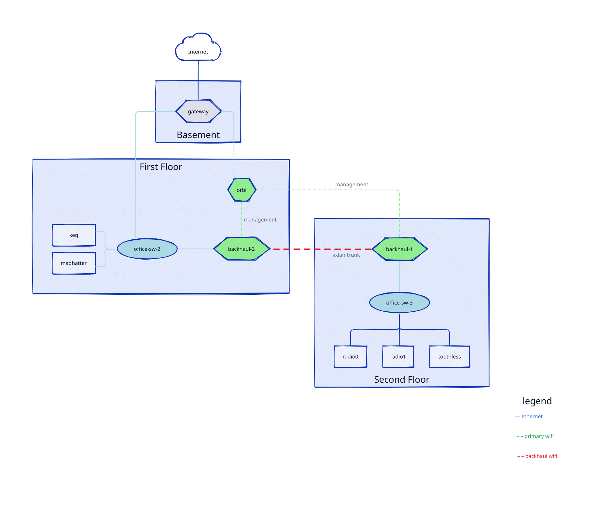

# House infrastructure

This directory contains:

- [PyInfra] code for managing devices (in this directory), and
- [Docker compose] projects for deploying services (in the [services/](services) directory)

[pyinfra]: https://pyinfra.com/
[docker compose]: https://docs.docker.com/compose/

## Network architecture



### House network

[FIOS] terminates at `gw.house`, an [Edgerouter-X] 5-port wired Ethernet router. This
connects to a [Netgear Orbi R750] with two satellites, which provide WiFi access to the house. There is a Ethernet connection between `gw.house` and `office-sw-2`, an HPE 1920 24-port switch running [OpenWrt]. This switch provides physical connectivity for devices in the downstairs office.

### Wireless backhaul

There is a second HPE 1920 switch in the upstairs work room named `office-sw-3` that provides physical connectivity to devices in that room. A pair of [Netgear R6400v1] routers are used to create a wireless backhaul between `office-sw-2` and `office-sw-3`:

- Router `backhaul-1` is located upstairs, where it connects to `office-sw-3`. `backhaul-1` is configured as a 5ghz access point.
- Router `backhaul-2` is located downstairs, where it connects to `office-sw-2`. `backhaul-2` is configured as a 5ghz station bridge.

A [VXLAN] channel between the two routers carries VLANs 101 and 102 between the two switches.

The bridge configuration on the routers looks like this:

| bridge name | bridge id         | STP enabled | interfaces    |
| ----------- | ----------------- | ----------- | ------------- |
| br0         | 8000.10da438fdfa3 | no          | eth1          |
| trunk0      | 8000.10da438fdfa1 | no          | eth0, transit |

- `eth1` is the 2.4ghz wireless interface, which is attached to the house wifi network for management access and exporting logs/emtrics.
- `eth2` is the 5ghz network interface and the transit network link on the `100.64.64.0/29` network
- `eth0` is the CPU port.

For reference purposes, the interface configuration on `backhaul-1` looks like this:

```sh
1: lo    inet 127.0.0.1/8 brd 127.255.255.255 scope host lo\       valid_lft forever preferred_lft forever
1: lo    inet6 ::1/128 scope host \       valid_lft forever preferred_lft forever
4: eth0    inet6 fe80::12da:43ff:fe8f:ab66/64 scope link \       valid_lft forever preferred_lft forever
5: vlan1    inet 10.18.25.1/29 scope global vlan1\       valid_lft forever preferred_lft forever
5: vlan1    inet6 fe80::12da:43ff:fe8f:ab66/64 scope link \       valid_lft forever preferred_lft forever
7: eth1    inet6 fe80::12da:43ff:fe8f:ab68/64 scope link \       valid_lft forever preferred_lft forever
8: eth2    inet 100.64.64.1/29 brd 100.64.64.7 scope global eth2\       valid_lft forever preferred_lft forever
8: eth2    inet6 fe80::12da:43ff:fe8f:ab79/64 scope link \       valid_lft forever preferred_lft forever
9: br0    inet 192.168.1.127/24 scope global br0\       valid_lft forever preferred_lft forever
9: br0    inet6 2600:4040:5f6d:500:12da:43ff:fe8f:ab68/64 scope global dynamic flags 100 \       valid_lft 85962sec preferred_lft 13962sec
10: trunk0    inet6 fe80::58f4:e1ff:fe9b:654a/64 scope link \       valid_lft forever preferred_lft forever
11: transit    inet6 fe80::c811:d2ff:fe8f:8531/64 scope link \       valid_lft forever preferred_lft forever
```

The configuration on `backhaul-2` is identical but for different addresses.

See [configure-transit-link.sh](roles/wifilink/files/configure-transit-link.sh) for details on how networking on the routers is configured.

[edgerouter-x]: https://store.ui.com/us/en/products/er-x
[FIOS]: https://www.verizon.com/home/internet/fios-fastest-internet
[orbi r750]: https://support.netgear.com/support/product/rbr750
[openwrt]: https://openwrt.org/
[netgear r6400v1]: https://support.netgear.com/support/product/r6400
[vxlan]: https://en.wikipedia.org/wiki/VXLAN
