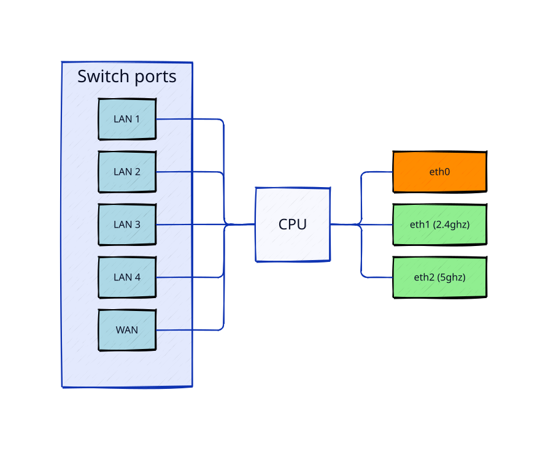

# Netgear R6400v1

The Netgear R6400v1 is a c. 2015 AC1750 wireless router, with 5 switch ports, a 2.4ghz radio, and a 5ghz radio.

## Ports

The switch ports are not realized as Linux devices. They are managed using the [swconfig] utility. Traffic on the switch ports is presented as tagged VLAN traffic on `eth0`.

[swconfig]: https://openwrt.org/docs/techref/swconfig
